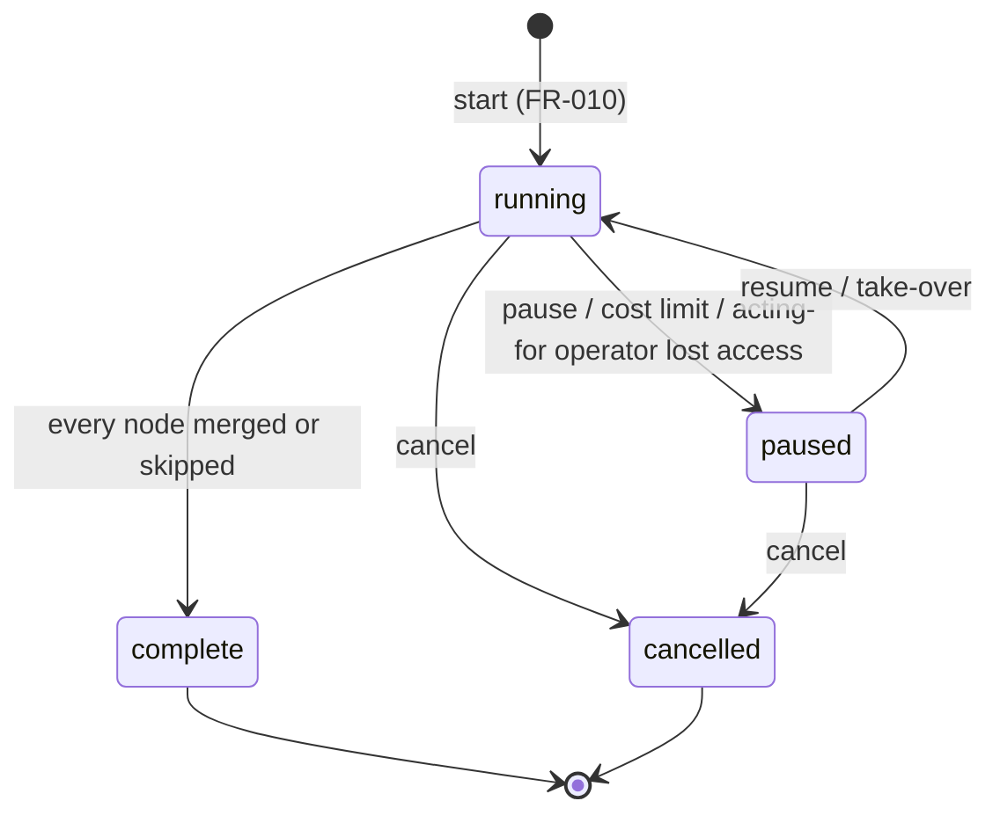
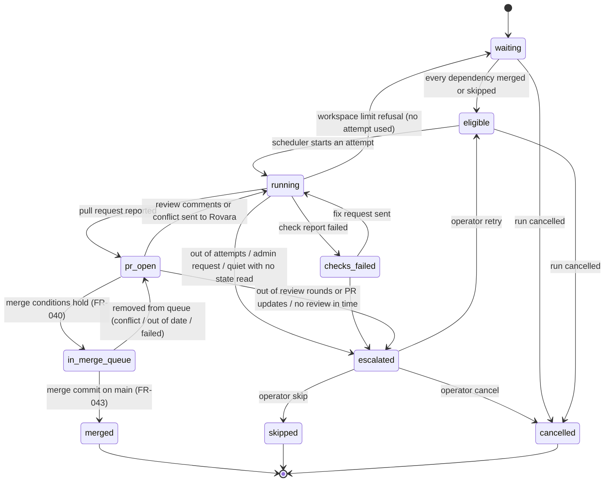

# Data Model: DAG Orchestrator for Rovara

**Feature**: [spec.md](spec.md) | **Plan**: [plan.md](plan.md) | **Research**: [research.md](research.md)

One DynamoDB table (R3). Every item has `pk`, `sk`, `entityType` and `version` (a number that every
update must match and increment). Times are ISO-8601 UTC. Ids are prefixed ULIDs (`dag_`, `run_`,
`att_`...) unless stated.

## Entities

### DAG

The imported graph, never changed after import (Principle II, FR-004).

| Key | Value |
|---|---|
| `pk` | `DAG#<dagId>` |
| `sk` | `META` |

| Field | Type | Rules |
|---|---|---|
| `dagId` | string | `dag_` + ULID, assigned at import |
| `hash` | string | `sha256:<64 hex>`; recomputed at import and must equal the file's (FR-002) |
| `repo` | string | `owner/name` of the monorepo, from `spec.repo` |
| `commit` | string | 40-hex commit of the spec; must be on the remote (FR-003) |
| `specDir` | string | repo-relative spec folder |
| `docs` | map | spec documents by name to repo-relative path |
| `feature` | string \| null | |
| `unit` | `"story"` | anything else refused (FR-003) |
| `nodeCount`, `edgeCount` | number | |
| `importedAt`, `importedBy` | string | importer is an operator id |
| `source` | object | the file as imported, stored in S3 when over 300 KB; key kept here |

Identity rule: a second item `pk = DAGHASH#<repo>#<hash>`, `sk = META`, written in the same
transaction with `attribute_not_exists(pk)`, maps the hash to the existing `dagId` (FR-005).

### Node (of a DAG)

`pk = DAG#<dagId>`, `sk = NODE#<nodeId>`. Copied from the graph's unit nodes at import.

| Field | Type | Rules |
|---|---|---|
| `nodeId` | string | the graph's unit id (`setup`, `foundational`, `US1`...) |
| `title`, `kind`, `priority`, `mvp` | | from the graph |
| `files` | string[] | repo-relative; directories (ending `/`) are not locked (R5) |
| `tasks` | object[] | ordered `{ id, title, text, ref, files }` |
| `dependsOn` | string[] | node ids, from the graph's edges |
| `doneAtImport` | boolean | `status == "done"` in the graph: counts as merged (FR-013) |

### Run

`pk = RUN#<runId>`, `sk = META`; also `pk = DAGRUN#<dagId>`, `sk = ACTIVE` while active, written
with `attribute_not_exists` so a DAG has at most one active run (FR-010).

| Field | Type | Rules |
|---|---|---|
| `runId`, `dagId`, `repo` | string | |
| `state` | enum | see Run states |
| `concurrencyLimit` | number | 1 to 5000 |
| `costLimitUsd` | number | > 0 |
| `retry` | object | `{ fixRequests: 2, attempts: 3, prUpdates: 3, reviewRounds: 3, quietMinutes: 30 }` defaults (FR-030) |
| `costUsd` | number | running total (FR-052); updated with atomic `ADD`, without the version check |
| `counts` | map | node count per node state (FR-053); updated with atomic `ADD` in each node transaction, without the version check, so 1000 concurrent nodes do not contend on the Run item. Every other Run field keeps the version check |
| `tracesExpireSetAt` | string \| null | when the run's trace items were given their `expiresAt` (Trace step) |
| `startedBy`, `actingFor` | string | operator ids; `actingFor` changes on take-over (FR-057) |
| `startedAt`, `endedAt` | string | |

### Node state (in a run)

`pk = RUN#<runId>`, `sk = NODE#<nodeId>`.

| Field | Type | Rules |
|---|---|---|
| `state` | enum | see Node states |
| `waitingFor` | object \| null | `{ reason: "dependencies" \| "files" \| "capacity" \| "paused" \| "main_red" \| "cost", detail }` |
| `currentAttempt` | string \| null | attempt id |
| `attempts` | number | used so far; a workspace-limit refusal does not count (FR-062) |
| `prUpdates`, `reviewRounds` | number | counted per node |
| `mergeCommit` | string \| null | set when merged (FR-043) |
| `escalation` | object \| null | `{ at, reason, slackTs }` |
| `skippedBy` | object \| null | `{ operator, reason, at }` |

### Attempt

`pk = ATT#<attemptId>`, `sk = META`. One Rovara conversation (FR-021).

| Field | Type | Rules |
|---|---|---|
| `attemptId`, `runId`, `nodeId`, `n` | | `n` is 1, 2, 3... |
| `conversation` | object | `{ channel: "orchestrator", tenant, space, thread }`; `thread = <runId>.<nodeId>.a<n>`, only `[A-Za-z0-9._:+@=-]`, at most 128 characters |
| `baseCommit` | string | main's commit when the attempt started (FR-014) |
| `phase` | enum | see Attempt phases |
| `plan` | object \| null | `{ requestId, revision, digest, approvedAt }` |
| `checkReports` | object[] | `{ status, at, text }` |
| `fixRequests` | number | within this attempt |
| `pullRequests` | object[] | `{ number, url, headSha, state, openedAt }`; every PR the attempt raised (FR-053) |
| `rovaraTaskIds` | string[] | when Rovara sends them (D3) |
| `rovaraTaskUrl` | string \| null | the task page link from Rovara's `approval_request.taskUrl`; shown as the node's Rovara task link (FR-053) |
| `outcome` | enum \| null | `merged`, `failed`, `abandoned`, `cancelled` |
| `due` | object | `{ quietAt, reviewAt, retryAt }`: times the sweep acts on (R2) |
| `costUsd` | number | |

### Question

`pk = ATT#<attemptId>`, `sk = Q#<eventId>`. One per Rovara `question` event (FR-027).

| Field | Rules |
|---|---|
| `question`, `choices` | as Rovara sent them |
| `answer`, `choice` | as sent back |
| `answeredBy` | model id, or `fixed-reply` |
| `tries`, `costUsd`, `at` | `tries` at most 3 before the fixed reply |

### Review comment

`pk = ATT#<attemptId>`, `sk = RC#<prNumber>#<threadId>`. One per review thread (FR-045).

| Field | Rules |
|---|---|
| `author`, `body`, `path`, `line`, `commit` | from GitHub |
| `round` | review round it was sent to Rovara in |
| `resolution` | `fixed` (commit sha), `answered` (reply id), `resolved_by_tool`, or null |

### Event (from Rovara)

`pk = ATT#<attemptId>`, `sk = EV#<receivedAt>#<eventId>`; also `pk = EVID#<eventId>`, `sk = META`
written with `attribute_not_exists` to drop repeats (FR-025). The raw signed body is kept.

### Trace step

`pk = TRACE#<attemptId>`, `sk = <sequence, zero-padded to 12>` (FR-055). Fields: `at`, `kind`,
`payload` (at most 64 KB, as Rovara sent it). Written with `attribute_not_exists(sk)`, so a repeat
is dropped (SC-010). Written without a TTL, because the run's end is not known yet; once the run
ends, the sweep sets `expiresAt = endedAt + 90 days` on every trace item of the run, once, and
records `tracesExpireSetAt` on the Run.

### Intent

`pk = ATT#<attemptId>`, `RUN#<runId>` or `REPO#<owner/name>` (whichever machine needs the effect), `sk = INTENT#<seq>`. Written in the
same transaction as the state change that needs it (R3).

| Field | Rules |
|---|---|
| `effect` | `rovara.message`, `rovara.decision`, `rovara.close`, `rovara.cancel`, `rovara.workspace_limit`, `github.enqueue`, `github.resolve_thread`, `github.comment`, `github.close_pr`, `slack.post`, `slack.reply`, `model.answer`, `queue.enqueue` (payload: the target group `att:`, `run:` or `repo:`, and the input) |
| `key` | idempotency key sent to the far end (Rovara `eventId`, GitHub expected head, Slack message key) |
| `payload` | everything needed to carry it out |
| `status` | `pending`, `done`, `failed`; `result` holds the far end's id (Slack `ts`, PR number) |
| `tries`, `nextTryAt` | retried with back-off; a `failed` intent escalates the node |

### Decision record

`pk = RUN#<runId>`, `sk = DEC#<at>#<id>` (FR-054). Fields: `actor` (operator id or `orchestrator`),
`action` (approve, answer, merge, retry, skip, cancel, escalate, pause, resume, take_over,
stop_switch, refused), `reason`, `nodeId?`, `attemptId?`, `detail`.

### Repository

`pk = REPO#<repo>`, `sk = META`: `paused` (main red, FR-044), `pausedSince`, `mainCommit`,
`startRate`, `throttle` window counters (R6), `rovaraFreeWorkspaces`, `notification` (`slackTs` of
the open main-red message).

Locks: `pk = REPO#<repo>`, `sk = LEASE` (scheduler lease, R5) and `sk = FILE#<path>` (file held by a
running node: `{ runId, nodeId }`) (FR-022).

### Global settings

`pk = SETTINGS`, `sk = GLOBAL`: `stopSwitch` `{ on, by, at, reason }` (FR-051), the notification
channel id, the review tool login and re-review comment, and the model id (R8).

### Operator

Not stored as a record: an operator is whoever Rovara's access check says it is, on every action
(FR-054). Decision records keep the operator's Rovara developer id and display name.

## State machines

Three machines, each fed by its own kind of queue group (research R2):

| Machine | Group | Inputs |
|---|---|---|
| Attempt | `att:<attemptId>` | Rovara events, GitHub events on the attempt's PR, timers, and inputs from the run machine (cancel, release of a held approval) |
| Run | `run:<runId>` | run start (capacity check), pause, resume, cancel, take-over, cost limit reached, acting-for operator lost access |
| Repository | `repo:<owner/name>` | main's required checks failing or passing |

A run or repository transition changes only its own item and writes a `queue.enqueue` intent for
each attempt it affects; it never writes an attempt directly.

### Run states

`paused` by cost limit or lost access resumes only through an operator action, which is recorded.

### Node states

These are the spec's canonical node states (Key Entities).

A node marked done at import starts in `merged`. A new attempt (after a workspace or conversation
failure, while attempts remain) goes `running -> eligible` and is started again by the scheduler.

### Attempt phases

Finer than node state; one attempt moves through:
`starting` (conversation opened) -> `planning` (plan requested) -> `coding` (plan approved) ->
`checked` (check report passed) -> `pr_requested` -> `pr_open` -> `reviewing` -> `queued` ->
`merged`, or ends `failed` / `abandoned` / `cancelled`. Each phase sets `due.quietAt` (FR-034).

## Validation rules (from requirements)

- Import: schema version 1, `unit: story`, recomputed hash equal, no cycle, every edge endpoint
  exists, `spec.dirty == false`, `spec.pushed == true` and the commit is on the remote (FR-001 to
  FR-003).
- Start: no active run for the DAG; `concurrencyLimit` and `costLimitUsd` set; the starting operator
  has a linked Rovara identity (FR-010, FR-057).
- Merge: all FR-040 conditions, evaluated together in one function with one test per condition.
- Every state change: the item's `version` matches, or the change is retried from a fresh read.
