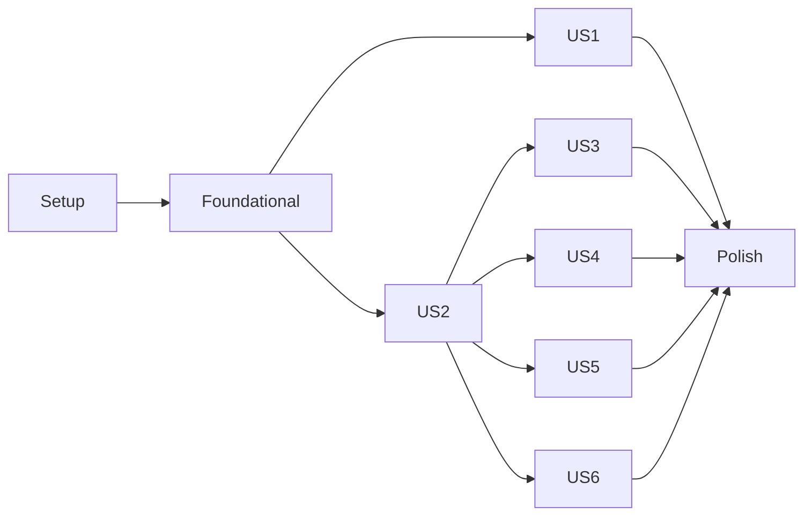

---

description: "Task list for the DAG Orchestrator for Rovara"
---

# Tasks: DAG Orchestrator for Rovara

**Input**: Design documents from `specs/001-dag-orchestrator/` (spec, plan, research, data model, contracts, quickstart)

**Prerequisites**: the plan and the spec (required); research, data model and contracts (used throughout)

**Tests**: Required. Constitution Principle VII makes tests mandatory and test-first: every
behaviour has a test task placed before the task that implements it, and that test must fail first.

**Organization**: Tasks are grouped by user story. Each user story phase is one unit of work for
`speckit-dag --unit story`, so this file can itself be run by the orchestrator.

## Format: `[ID] [P?] [Story] Description`

- **[P]**: Can run in parallel (different files, no dependencies on incomplete tasks)
- **[Story]**: Which user story this task belongs to (US1 to US6)
- Every task names the files it creates or changes. A task never names a file it only reads, so
  speckit-dag's same-file ordering reflects real edits only.

## Path Conventions

npm-workspaces repository: `packages/<name>/src/` for code (unit tests beside it as `*.test.ts`),
`tests/<kind>/` for cross-package tests, `infra/` for the AWS CDK app with its tests in
`infra/test/`. See the plan's Project Structure.

## Extension points

Foundational tasks create every file that more than one story would otherwise edit: the machine's
handler modules, the scheduler's gate modules, the API's route modules, the CLI's command modules,
the GitHub event handlers and the effect executors, each as a stub. Each story then fills in its own
files. The few files two stories both edit are listed under Dependencies.

---

## Phase 1: Setup (Shared Infrastructure)

**Purpose**: Repository, tooling and CI

- [X] T001 Create the root workspace: `package.json` with npm workspaces `packages/*` and `infra`, scripts `lint`, `typecheck`, `test`, `test:contract`, `test:fault`, `test:e2e`, `load`, `deploy`, `db:up`; `tsconfig.base.json` (strict, target ES2023, module and moduleResolution NodeNext); `.nvmrc` containing `22.19.0`
- [X] T002 [P] Add ESLint (typescript-eslint, flat config) and Prettier in `eslint.config.js` and `.prettierrc`
- [X] T003 [P] Add Vitest projects in `vitest.config.ts`: one per package for unit tests, plus `infra/test`, `tests/contract`, `tests/integration` and `tests/fault`; exclude `tests/e2e` and `tests/load` from the default run
- [X] T004 [P] Add `.gitignore` (node_modules, dist, cdk.out, `.cache/`) and a `README.md` stating what the orchestrator does, linking the spec folder, and listing the test commands
- [X] T005 Scaffold the 13 workspace packages from the plan (core, store, dag-import, rovara, github, slack, answerer, identity, api, workers, cli, web, testkit): for each, `packages/<name>/package.json` (name `@rovara-orch/<name>`, `"type": "module"`), `packages/<name>/tsconfig.json` extending the base, and `packages/<name>/src/index.ts` (depends on T001)
- [X] T006 [P] Add `docker-compose.yml` running `amazon/dynamodb-local` on port 8000 for local and fault tests
- [X] T007 [P] Add CI in `.github/workflows/ci.yml`: Node 22.19, `npm ci`, lint, typecheck, unit, infra, contract and fault tests, with DynamoDB Local as a service container
- [X] T008 [P] Create the CDK app skeleton: `infra/package.json`, `infra/cdk.json`, `infra/bin/app.ts` and `infra/lib/stage.ts` defining stages `test`, `load` and `prod`, with a `prod` flag the identity package reads
- [X] T009 [P] Write runtime guidance in `CLAUDE.md` at the repository root: the seven constitution principles in one line each, test-first rule, package map, commands, and that Rovara is reached only through its published interfaces

---

## Phase 2: Foundational (Blocking Prerequisites)

**Purpose**: Domain model, storage with exactly-once effects, the event pipeline, the Rovara,
GitHub and Slack plumbing, the operator API and CLI frames, the test kit with fakes, and the
infrastructure stacks. No user story can start before this phase is done.

### Domain and storage

- [X] T010 [P] Create prefixed ULID ids (`dag_`, `run_`, `att_`, `dec_`) and the attempt thread id `<runId>.<nodeId>.a<n>`, validated to use only `[A-Za-z0-9._:+@=-]` and at most 128 characters, in `packages/core/src/ids.ts`, an injectable clock in `packages/core/src/clock.ts`, and tests in `packages/core/src/ids.test.ts`
- [X] T011 Define the domain types in `packages/core/src/model.ts` exactly as in the data model: node states `waiting`, `eligible`, `running`, `checks_failed`, `pr_open`, `in_merge_queue`, `merged`, `escalated`, `skipped`, `cancelled`; run states `running`, `paused`, `complete`, `cancelled`; attempt phases `starting`, `planning`, `coding`, `checked`, `pr_requested`, `pr_open`, `reviewing`, `queued`, `merged`, `failed`, `abandoned`, `cancelled`; intent effects `rovara.message|rovara.decision|rovara.close|rovara.cancel|rovara.workspace_limit|github.enqueue|github.resolve_thread|github.comment|github.close_pr|slack.post|slack.reply|model.answer|queue.enqueue`; retry defaults `{ fixRequests: 2, attempts: 3, prUpdates: 3, reviewRounds: 3, quietMinutes: 30 }`; `concurrencyLimit` "1 to 5000"; `costLimitUsd` "> 0"; the `waitingFor` reason one of `dependencies`, `files`, `capacity`, `paused`, `main_red`, `cost` (depends on T010)
- [X] T012 Define the pure transition contract `(state, input, ctx) => { next, intents, decisions } | undefined` and the input union (Rovara events, GitHub events, timers, operator actions, scheduler start) in `packages/core/src/machine/types.ts`; create three machine entry points that share that contract: the attempt machine in `packages/core/src/machine/attempt.ts` (Rovara events, GitHub events on the attempt's PR, timers, and inputs from the run machine; composes the handlers in the fixed order happy-path, review, failures, conflicts, controls, capacity, first handler returning a transition wins), the run machine in `packages/core/src/machine/run.ts` (run start, pause, resume, cancel, take-over, cost limit reached, acting-for operator lost access; calls the run-level functions of the controls and capacity handlers) and the repository machine in `packages/core/src/machine/repository.ts` (main's required checks failing or passing); create the six handler files `packages/core/src/machine/handlers/happy-path.ts`, `packages/core/src/machine/handlers/review.ts`, `packages/core/src/machine/handlers/failures.ts`, `packages/core/src/machine/handlers/conflicts.ts`, `packages/core/src/machine/handlers/controls.ts` and `packages/core/src/machine/handlers/capacity.ts` as stubs returning `undefined` (depends on T011)
- [X] T013 Create `pick(snapshot) -> starts[]` in `packages/core/src/scheduler/pick.ts`: apply gate modules in the order controls, repo-health, eligibility, file-locks, throttle, then cap the result at capacity and order it MVP first, then priority (P1 before P2), then DAG order; create the five gate files `packages/core/src/scheduler/gates/controls.ts`, `packages/core/src/scheduler/gates/repo-health.ts`, `packages/core/src/scheduler/gates/eligibility.ts`, `packages/core/src/scheduler/gates/file-locks.ts` and `packages/core/src/scheduler/gates/throttle.ts` as pass-through stubs (depends on T011)
- [X] T014 [P] Write key builders for every item in the data model in `packages/store/src/keys.ts`: `DAG#<dagId>` with `META` and `NODE#<nodeId>`; `DAGHASH#<repo>#<hash>`; `DAGRUN#<dagId>` with `ACTIVE`; `RUN#<runId>` with `META`, `NODE#<nodeId>` and `DEC#<at>#<id>`; `ATT#<attemptId>` with `META`, `Q#<eventId>`, `RC#<prNumber>#<threadId>`, `EV#<receivedAt>#<eventId>` and `INTENT#<seq>`; `EVID#<eventId>`; `TRACE#<attemptId>` with the sequence zero-padded to 12; `REPO#<repo>` with `META`, `LEASE` and `FILE#<path>`; `SETTINGS` with `GLOBAL`; tests in `packages/store/src/keys.test.ts`
- [X] T015 Implement the table client in `packages/store/src/table.ts`: DocumentClient wrapper whose `transact(writes)` adds the condition `version = :expected` and sets `version = :expected + 1` on every update, throws a typed `VersionConflict`, and offers `withFreshRead(fn, maxTries = 5)`; test in `packages/store/src/table.test.ts` on DynamoDB Local that of two concurrent writers exactly one wins (depends on T014)
- [X] T016 Implement `applyTransition` in `packages/store/src/apply-transition.ts`: write the state item update, every intent item (status `pending`) and every decision record in one transaction, with counter changes (atomic `ADD` on the Run's `counts` and `costUsd`) in the same transaction but outside the version condition; test in `packages/store/src/apply-transition.test.ts` that a failed condition writes none of them and that two transitions adding to the same Run counter both succeed (depends on T012, T015)
- [X] T017 [P] Implement item access in `packages/store/src/repositories.ts` for DAG (with the hash identity item written with `attribute_not_exists(pk)`), Node, Run (with the active-run item written with `attribute_not_exists(pk)`), NodeRunState, Attempt, Repository and Settings (stop switch, notification channel id, review tool login, re-review comment, model id); tests in `packages/store/src/repositories.test.ts` (depends on T015)

### Event pipeline

- [X] T018 Implement the intent runner in `packages/workers/src/intent-runner.ts` as a DynamoDB stream consumer: for each new `pending` intent, find its executor in `packages/workers/src/effects/registry.ts`, run it, mark it `done` with its `result`, or increase `tries` and set `nextTryAt` with exponential back-off, marking it `failed` after 8 tries; implement `packages/workers/src/effects/queue-enqueue.ts` (sends the input to its SQS FIFO group with `MessageDeduplicationId` = the intent's key); create stub executors that throw `NotImplemented` in `packages/workers/src/effects/rovara-send.ts`, `packages/workers/src/effects/rovara-decision.ts`, `packages/workers/src/effects/rovara-close.ts`, `packages/workers/src/effects/rovara-cancel.ts`, `packages/workers/src/effects/rovara-workspace-limit.ts`, `packages/workers/src/effects/github-enqueue.ts`, `packages/workers/src/effects/github-review.ts`, `packages/workers/src/effects/github-comment.ts`, `packages/workers/src/effects/github-pr.ts`, `packages/workers/src/effects/slack.ts` and `packages/workers/src/effects/model-answer.ts`; test in `packages/workers/src/intent-runner.test.ts` that an intent delivered twice, with the runner killed between execute and mark-done, reaches the far end once by its idempotency key, and that an enqueue intent run twice puts one message on the queue (depends on T016)
- [X] T019 Implement the work consumer in `packages/workers/src/work-consumer.ts` for SQS FIFO with three kinds of message group: `att:<attemptId>` (attempt machine), `run:<runId>` (run machine) and `repo:<owner/name>` (repository machine); load the items the machine needs, call it, apply the transition, and retry from a fresh read on `VersionConflict` up to 5 times; a run or repository transition never writes an attempt and instead writes, in its own transaction, one enqueue intent per affected attempt; after any transition that merges, skips, escalates or cancels a node or returns it to waiting, it writes an enqueue intent for a scheduler pass on its repository, keyed so there is at most one per repository every 5 seconds; nothing in the consumer sends to the queue directly; test in `packages/workers/src/work-consumer.test.ts` (depends on T016, T017)
- [X] T020 Implement the sweep in `packages/workers/src/sweep.ts`, run every minute: enqueue timer inputs for attempts whose quiet, review or retry due-time (the attempt's `due` field) has passed, and one scheduler pass per repository with a running run; test in `packages/workers/src/sweep.test.ts` (depends on T019)
- [X] T021 Implement the scheduler worker in `packages/workers/src/scheduler.ts` and the per-repository lease in `packages/store/src/leases.ts` (conditional put on `REPO#<repo>` / `LEASE` with a 60-second expiry, renewed each pass): load a snapshot, call `pick`, and for each start create the attempt and its first intent in one transaction; test in `packages/workers/src/scheduler.test.ts` that of two concurrent passes only one acts (depends on T013, T017)

### Rovara plumbing

- [X] T022 [P] Write pinned zod copies of the Rovara channel-adapter shapes used, in `packages/rovara/src/contract/channel.ts`: ConversationRef, ActorRef, InboundMessage `version: 2`, ChannelDecision `version: 1` with `decision` one of `APPROVE`, `REQUEST_CHANGES`, `REJECT`, `SKIP` and `reason` 1 to 500 characters, and the event union `ack`, `message`, `progress`, `question`, `approval_request`, `check_report`, `pr`, `done`, `error`, `link_required`; export `PINNED_ROVARA_COMMIT` (the full sha of `c35d5967` on Rovara `mainline`) from `packages/rovara/src/contract/pinned.ts`
- [X] T023 [P] Implement Standard Webhooks signing and verification in `packages/rovara/src/signing.ts` with the `standardwebhooks` package, headers `webhook-id`, `webhook-timestamp`, `webhook-signature`, refusing timestamps more than 5 minutes off; tests in `packages/rovara/src/signing.test.ts`
- [X] T024 Implement the channel client in `packages/rovara/src/client.ts`: `sendMessage(conversation, actor, text, eventId)` to `POST /v1/channels/orchestrator/messages` and `sendDecision(decision)` to `POST /v1/channels/orchestrator/decisions`, signed with the adapter secret; map HTTP 429 to `Throttled` and a workspace-limit refusal to `WorkspaceLimit`; tests in `packages/rovara/src/client.test.ts` (depends on T022, T023)
- [X] T025 Implement the Rovara callback ingress in `packages/workers/src/ingress-rovara.ts` for `POST /rovara/events`: verify the signature and require `channel == "orchestrator"`; then, in one transaction, write `EVID#<eventId>` with `attribute_not_exists(pk)`, the raw event under its attempt, the writes of the hooks listed in `packages/workers/src/rovara-event-hooks.ts` (created empty), and an enqueue intent for the group `att:<attemptId>` parsed from the conversation thread; answer 2xx only after that transaction commits; a repeat (the condition fails) answers 2xx and writes nothing; events for unknown threads are stored and logged with no enqueue intent; nothing is sent to the queue directly; tests in `packages/workers/src/ingress-rovara.test.ts`, including that with the process stopped after the commit and before the answer, Rovara's resend is processed exactly once (depends on T017, T023)
- [X] T026 [P] Write the Rovara contract test in `tests/contract/rovara-channel.test.ts` with `scripts/fetch-rovara-contracts.sh`: sparse-check-out Rovara at `PINNED_ROVARA_COMMIT` into `.cache/rovara`, import its channel-adapter and conversation schemas, and round-trip the fixtures in `tests/contract/fixtures/rovara/` both ways (every Rovara event parses with our copy; every request we build parses with Rovara's schema) (depends on T022)

### GitHub and Slack plumbing

- [X] T027 [P] Implement GitHub App authentication with Octokit (REST and GraphQL, installation-token cache) in `packages/github/src/app.ts`, and webhook verification (`X-Hub-Signature-256`) with repeat dropping by `X-GitHub-Delivery` in `packages/github/src/webhooks.ts`; tests in `packages/github/src/webhooks.test.ts`
- [X] T028 Implement the GitHub ingress in `packages/workers/src/ingress-github.ts` for `POST /github/events`: verify the signature, route by event type to handler modules that return the attempt or repository inputs the event produces (created as stubs returning none), then, in one transaction, write the `X-GitHub-Delivery` marker with `attribute_not_exists(pk)` and one enqueue intent per input, and answer 2xx only after it commits (a repeat answers 2xx and writes nothing; nothing is sent to the queue directly); the handler modules are `packages/workers/src/github-events/pull-requests.ts`, `packages/workers/src/github-events/reviews.ts`, `packages/workers/src/github-events/checks.ts`, `packages/workers/src/github-events/merge-group.ts`, `packages/workers/src/github-events/main-push.ts` and `packages/workers/src/github-events/main-checks.ts` (check events on main's head go to the main-checks handler); tests in `packages/workers/src/ingress-github.test.ts`, including that with the process stopped after the commit and before the answer, GitHub's redelivery is processed exactly once (depends on T017, T027)
- [X] T029 Implement Slack notifications in `packages/slack/src/messages.ts` (the first-message and thread-reply texts for the five causes in the notifications contract: node escalated, repository paused, run at cost limit, administrator request, acting-for operator lost access) and `packages/slack/src/notify.ts` (`chat.postMessage`, thread replies by stored `ts`); replace the stub in `packages/workers/src/effects/slack.ts` so an intent whose `result` already has a `ts` is never posted again; tests in `packages/slack/src/notify.test.ts` (depends on T018)

### Identity, API and CLI frames

- [X] T030 [P] Define `OperatorIdentity` (`verify(token) -> Operator`, `access(operator) -> { isOperator, isAdmin }`) in `packages/identity/src/operator-identity.ts` and a development-only implementation from a fixed operator list in `packages/identity/src/dev.ts` that throws on construction when the stage is `prod`; tests in `packages/identity/src/dev.test.ts`
- [X] T031 Implement the operator API frame: router Lambda in `packages/api/src/router.ts`; error shape `{ error: { code, message } }` with `AUTH_REQUIRED` 401, `NOT_OPERATOR` 403, `NOT_FOUND` 404, `CONFLICT` 409, `INVALID` 422, `STOPPED` 423, `UNAVAILABLE` 503 in `packages/api/src/errors.ts`; operator check on every route, recording each refusal as a decision with action `refused`, in `packages/api/src/auth.ts`; `Idempotency-Key` handling (first result kept 24 hours) in `packages/api/src/idempotency.ts`; `recordAndEnqueue(decision, input)` in `packages/api/src/record-and-enqueue.ts`, writing the decision record and an enqueue intent in one transaction keyed by the `Idempotency-Key`, so a retried request finds the same intent and never loses or doubles the input; route modules created as stubs answering 501: `packages/api/src/routes/dags.ts`, `packages/api/src/routes/runs.ts`, `packages/api/src/routes/runs-control.ts`, `packages/api/src/routes/nodes-read.ts`, `packages/api/src/routes/nodes-actions.ts`, `packages/api/src/routes/trace.ts`, `packages/api/src/routes/stop-switch.ts`, `packages/api/src/routes/repos.ts`; tests in `packages/api/src/router.test.ts` (depends on T017, T030)
- [X] T032 [P] Implement the CLI frame: `rovara-orch` with commander, global `--url` (or `ROVARA_ORCH_URL`) and `--json`, exit codes 0 success, 1 refused or invalid, 2 usage, 3 unreachable, in `packages/cli/src/main.ts`; HTTP client with the token kept in the OS keychain in `packages/cli/src/client.ts`; `login`, `logout` and `whoami` against the development identity in `packages/cli/src/commands/auth.ts`, with tests in `packages/cli/src/commands/auth.test.ts`; command modules created as stubs: `packages/cli/src/commands/dag.ts`, `packages/cli/src/commands/run.ts`, `packages/cli/src/commands/run-control.ts`, `packages/cli/src/commands/node.ts`, `packages/cli/src/commands/node-read.ts`, `packages/cli/src/commands/stop.ts` and `packages/cli/src/commands/repo.ts`

### Test kit

- [X] T033 [P] Implement fault injection in `packages/testkit/src/faults.ts` (seeded duplicate, delay, drop and reorder of deliveries), per-test-file DynamoDB Local tables in `packages/testkit/src/dynamo.ts`, and a fake clock in `packages/testkit/src/clock.ts`
- [X] T034 Implement the fake Rovara in `packages/testkit/src/fake-rovara.ts`: accepts signed messages and decisions, drops repeated `eventId`s, and replays a scripted scenario per conversation (ack, approval_request with a `taskUrl`, check_report, pr, done; questions; workspace-limit refusals; errors), sending signed callbacks through the fault injector (depends on T022, T023, T033)
- [X] T035 Implement the fake GitHub in `packages/testkit/src/fake-github.ts`: pull requests with heads and changed files, review threads by a bot login, check runs on PR heads and on main, a merge queue honouring `expectedHeadOid`, and main's commit history, sending signed webhooks through the fault injector (depends on T027, T033)
- [X] T036 [P] Implement the fake Slack in `packages/testkit/src/fake-slack.ts` and the fake answering model in `packages/testkit/src/fake-model.ts` (scripted answers, refusals, API errors, unparsable output) (depends on T033)
- [X] T037 Implement the in-process harness in `packages/testkit/src/harness.ts`: wire every package with the fakes and DynamoDB Local; `runDag(dag, options)` drives the scheduler, sweep, work consumer and intent runner until nothing is pending; `crashAt(boundary)` stops and restarts the process at any intent boundary; `faultCounts()` reports how many duplicates, delays, drops, reorders and restarts were injected (depends on T018, T019, T020, T021, T025, T028, T034, T035, T036)

### Infrastructure

- [X] T038 [P] Write CDK assertion tests for the data stack in `infra/test/data.test.ts`: the table has `pk` and `sk`, on-demand billing, point-in-time recovery, TTL attribute `expiresAt` and stream `NEW_IMAGE`; the DAG bucket blocks public access; the four secret entries exist (depends on T008)
- [X] T039 [P] Write CDK assertion tests for the service stack in `infra/test/service.test.ts`: the three API routes; the FIFO queue in high-throughput mode with a dead-letter queue; the intent runner on the table stream; the one-minute sweep schedule; one role per function, with no wildcard actions (depends on T008)
- [X] T040 Create the data stack in `infra/lib/data.ts` (DynamoDB table with `pk` and `sk`, on-demand, point-in-time recovery, TTL attribute `expiresAt`, stream `NEW_IMAGE`; S3 bucket for imported DAG files over 300 KB) and the secret entries in `infra/lib/secrets.ts` (Rovara adapter signing secret, GitHub App private key, GitHub webhook secret, Slack token) to pass T038 (depends on T038)
- [X] T041 Create the service stack in `infra/lib/service.ts` to pass T039: HTTP API with `POST /rovara/events`, `POST /github/events` and `ANY /v1/{proxy+}`; Lambdas (Node 22, arm64) for both ingresses, the operator API, the work consumer (SQS FIFO in high-throughput mode, with a dead-letter queue), the intent runner (table stream), the scheduler and the sweep (EventBridge Scheduler, every minute); one least-privilege role per function (depends on T039, T040)

**Checkpoint**: the platform runs events end to end with stub handlers; stories can start.

---

## Phase 3: User Story 1 - Import a DAG and get a dag-id (Priority: P1)

**Goal**: An operator imports a speckit-dag JSON file and gets a dag-id that always means exactly
that graph; unsafe graphs are refused with a reason.

**Independent Test**: Import speckit-dag's example `units.json`: a dag-id comes back, and the
stored graph has the same nodes, edges and hash. Import it again: the same dag-id. Import a copy
with one task's text changed: a new dag-id. Import a graph built from uncommitted spec files:
refused.

### Tests for User Story 1

- [X] T042 [P] [US1] Generate fixtures with speckit-dag at commit `5a410b5` into `tests/contract/fixtures/speckit-dag/` (the example spec as `tests/contract/fixtures/speckit-dag/units.json`; a copy with one task's text edited; a copy with one checkbox ticked; a hand-made cycle; a `unit: task` graph; a graph whose `spec` has `dirty` true; a graph whose `spec` has `pushed` false), with `tests/contract/fixtures/speckit-dag/regenerate.sh` documenting the commands
- [X] T043 [P] [US1] Write hash tests in `packages/dag-import/src/hash.test.ts`: the recomputed hash equals speckit-dag's recorded hash for every fixture; the edited copy differs; the checkbox-ticked copy is the same (depends on T042)
- [X] T044 [P] [US1] Write validation tests in `packages/dag-import/src/validate.test.ts`: one fixture per refusal `problem`, in the order checked: `schema`, `version`, `unit`, `hash_mismatch`, `cycle`, `unknown_node`, `spec_dirty`, `spec_not_pushed`, `commit_not_on_remote` (depends on T042)
- [X] T045 [P] [US1] Write the import integration test in `tests/integration/dag-import.test.ts` against the API with the fake GitHub: first import returns `201 { dagId, hash, created: true }`; the same file returns `200 { created: false }` with the same dagId; the edited copy returns a new dagId; list and show return `dagId, feature, repo, commit, nodeCount, hash, importedAt, importedBy` (depends on T042)
- [X] T046 [P] [US1] Write CLI tests in `packages/cli/src/commands/dag.test.ts` against a stub API: `dag import` prints the dag-id and whether it was new; `dag list` and `dag show` print the stored fields; `--json` output; exit code 1 on a refused import with its `problem`

### Implementation for User Story 1

- [X] T047 [P] [US1] Write the zod schema for the speckit-dag version-1 unit graph in `packages/dag-import/src/schema.ts`: `version` must be `1`; `unit` must be `"story"`; `hash` matches `sha256:<64 hex>`; `spec` has `repo`, `branch`, `commit` (40 hex), `dirty`, `pushed`, `dir` and `docs`; nodes carry ordered tasks with `id`, `title`, `text`, `ref` and `files`; edges are `{ from, to, reasons, via }`
- [X] T048 [US1] Port speckit-dag's content hash in `packages/dag-import/src/hash.ts`: hash a payload of `version`, `unit`, `groups`, `nodes` and `edges`; remove `ref`, `line`, `end_line` and `status` from groups, nodes and nested tasks; in `text`, replace a list item's `[x]` or `[X]` with `[ ]`; serialise with keys sorted and no whitespace (separators `,` and `:`), keeping non-ASCII characters as they are and escaping control characters the way Python's `json` module does with `ensure_ascii=False`; prefix the sha256 hex with `sha256:` (depends on T043, T047)
- [X] T049 [US1] Implement graph checks in `packages/dag-import/src/graph.ts`: every edge endpoint exists (`unknown_node`), and there is no cycle (`cycle`, reporting the cycle's node ids) (depends on T047)
- [X] T050 [US1] Implement source checks in `packages/dag-import/src/remote.ts`: refuse a `spec` whose `dirty` is true (`spec_dirty`) or whose `pushed` is false (`spec_not_pushed`); through the GitHub App, refuse a spec commit that does not exist in the spec's repository or is not reachable from any branch (`commit_not_on_remote`) (depends on T047)
- [X] T051 [US1] Implement import in `packages/dag-import/src/import.ts`: run the checks in the order of T044 and stop at the first problem; then write in one transaction the DAG item, one Node item per unit node (`doneAtImport` = node `status == "done"`; `dependsOn` from edges) and the hash identity item with `attribute_not_exists(pk)`; on that condition failing, return the existing dagId with `created: false`; keep files over 300 KB in S3 (depends on T044, T048, T049, T050)
- [X] T052 [US1] Implement `POST /v1/dags`, `GET /v1/dags` (paged) and `GET /v1/dags/{dagId}` per the operator API contract in `packages/api/src/routes/dags.ts`, replacing the stub (depends on T045, T051)
- [X] T053 [US1] Implement `dag import <file>`, `dag list` and `dag show <dagId>` in `packages/cli/src/commands/dag.ts`, replacing the stub (depends on T046, T052)

**Checkpoint**: US1 works alone: DAGs import, re-import, and refuse with reasons.

---

## Phase 4: User Story 2 - Run a DAG to completion with no person involved (Priority: P1) 🎯 MVP

**Goal**: Start a run for a dag-id; every unblocked node goes to Rovara, gets its plan approved,
its questions answered, its PR opened and reviewed, and is merged through the queue; dependents
start from the new main; the run completes. From the first version an operator can pause, resume
or cancel a run and stop everything at once (Constitution VI).

**Independent Test**: Through the harness, a 3-node DAG (Foundational, then US1 and US2 in
parallel) merges three PRs, Foundational first, with each child based on main at or after its
parent's merge; restarting at every intent boundary under duplicated, delayed, dropped and
reordered deliveries still gives exactly one conversation, PR and merge per node; the stop switch
and pause hold all starts, approvals and merges until released.

### Tests for User Story 2

- [X] T054 [P] [US2] Write happy-path transition tests in `packages/core/src/machine/handlers/happy-path.test.ts`: attempt phases `starting`, `planning`, `coding`, `checked`, `pr_requested`, `pr_open`, `reviewing`, `queued`, `merged` in order; a `plan_approval` request records its `taskUrl` as the node's Rovara task link and produces a decision intent echoing `requestId`, `expectedRevision` and `artifactDigest`; while the stop switch is on, that approval is held, and it is sent once when the switch turns off; a passed check report with no PR produces the "create the pull request" message; a question produces an answer-model intent; a node counts as merged only once its merge commit is on main; an event for an attempt that is not current changes nothing; every transition that approves, answers, merges, retries, escalates or pauses writes a decision record
- [X] T055 [P] [US2] Write scheduler property tests (fast-check, 10,000 random DAGs) in `packages/core/src/scheduler/gates/eligibility.test.ts`: no node starts unless every dependency is merged or skipped; nodes done at import count as merged; starts never exceed the run's concurrency limit or Rovara's free workspaces; order is MVP first, then priority, then DAG order
- [X] T056 [P] [US2] Write controls-gate tests in `packages/core/src/scheduler/gates/controls.test.ts`: nothing starts while the stop switch is on or the run is paused, cancelled or over its cost limit, with the `waitingFor` reason `paused` or `cost`
- [X] T057 [P] [US2] Write merge-gate tests in `packages/core/src/merge-gate.test.ts`: one failing case per condition (not the current attempt's reported PR; another repository; base not main; check report not `passed`; no changes; review tool has not reviewed the latest commit; an unresolved review comment; required CI failing on the PR; required CI failing in the merge queue; repository paused; stop switch on) and the all-pass case
- [X] T058 [P] [US2] Write review-loop tests in `packages/core/src/machine/handlers/review.test.ts`: unresolved review-tool comments on the latest commit go to Rovara as one review round; a thread counts as resolved when the tool resolves it or after Rovara fixed it with a commit or replied with a reason; out of review rounds with comments left escalates; no review within 30 minutes asks for one more; none 30 minutes later escalates; a PR is never queued without that review
- [X] T059 [P] [US2] Write control transition tests in `packages/core/src/machine/handlers/controls.test.ts`: pause stops new starts while running nodes and merges continue; resume; cancel adds cancel intents for running tasks, close intents for their workspaces and PR-close intents for unmerged PRs, each once
- [X] T060 [P] [US2] Write answering tests in `packages/answerer/src/answer.test.ts` with the fake model: a structured answer is sent unchanged; a `choice` not among the offered choices is dropped; a refusal goes to the client-side fallback, and a second refusal sends the fixed reply; 3 API errors send the fixed reply; unparsable output sends the fixed reply; the fixed reply is exactly "Follow the spec; choose the simplest option that meets it, and list the choice in the PR description."
- [X] T061 [P] [US2] Write executor tests in `packages/workers/src/effects/effects.test.ts` against the fakes: each Rovara, GitHub and model executor reaches the far end once per idempotency key when run twice; every Rovara request names the run's `actingFor` operator as its actor
- [X] T062 [P] [US2] Write GitHub webhook contract tests in `tests/contract/github-webhooks.test.ts` with recorded payloads in `tests/contract/fixtures/github/` for PR opened, synchronize and closed (merged and not merged), review, review comment, review thread, check suite, check run, status and merge group: each maps to the expected attempt input
- [X] T063 [P] [US2] Write CLI tests against a stub API in `packages/cli/src/commands/run.test.ts` (`run start` with each retry option, the not-linked case printing Rovara's link URL with exit code 1, `run list`, `run status`), `packages/cli/src/commands/run-control.test.ts` (`run pause`, `resume`, `cancel` with `--reason` required) and `packages/cli/src/commands/stop.test.ts` (`stop on`, `off`, `status`)
- [X] T064 [P] [US2] Write message-text tests in `packages/core/src/text/brief.test.ts`: the node brief contains the node's title and kind, every task's full text in DAG order, the spec folder path and each document path at the DAG's commit, the base commit, and all four instructions (implement in order, keep to the listed files, run the checks, do not open a pull request until asked); the review-round message lists each comment's file, line and link
- [X] T065 [US2] Write the run fault test in `tests/fault/run-happy-path.test.ts` with the harness: the 3-node DAG merges in dependency order; each child's base commit is at or after its parent's merge commit; repeating the run with a restart at every intent boundary and with duplicated, delayed, dropped and reordered deliveries gives exactly one conversation per attempt, one PR, one plan approval and one merge per node, and one decision record per automatic action; turning the stop switch on mid-run holds every start, approval and merge until it is off; the harness's fault counts show every fault type occurred at least once (SC-002, SC-004) (depends on T037)
- [X] T066 [US2] Write the cancel fault test in `tests/fault/cancel.test.ts` with the harness: cancelling mid-run stops running tasks, closes their workspaces and closes unmerged PRs, each exactly once; a cancel arriving while a node is merging ends either merged (merge completed) or cancelled (PR closed), never both, and nothing merges after a recorded cancel; with the process stopped right after `run cancelled` is stored, every running attempt is still cancelled exactly once; with the API stopped after recording a cancel and the operator retrying with the same `Idempotency-Key`, exactly one cancel is applied (depends on T037)

### Implementation for User Story 2

- [X] T067 [P] [US2] Write the message texts in `packages/core/src/text/brief.ts`: the node brief (node title and kind; every task's full text in order; the spec folder and its document paths at the DAG's commit; the base commit; and the instruction to implement the tasks in order, keep to the listed files where possible, run the project's checks, and not open a pull request until asked), "Checks passed. Create the pull request.", and the review-round message listing each comment with its file, line and link (depends on T064)
- [X] T068 [P] [US2] Implement GitHub reads and PR actions in `packages/github/src/commits.ts` (main's head; whether a commit is reachable from main) and `packages/github/src/pull-requests.ts` (a PR's head sha, state, base and changed-file count; the PR number parsed from Rovara's `pr` URL until Rovara#438; closing a PR, where closing a closed PR is a no-op)
- [X] T069 [P] [US2] Implement review-thread access in `packages/github/src/review.ts` (GraphQL `reviewThreads` filtered by the configured review-tool login; `resolveReviewThread`; the configured re-review comment) and replace the stubs `packages/workers/src/effects/github-review.ts` and `packages/workers/src/effects/github-comment.ts`, the latter posting at most one re-review comment per head commit (depends on T061)
- [X] T070 [P] [US2] Implement merging in `packages/github/src/merge-queue.ts` (GraphQL `enqueuePullRequest` with `expectedHeadOid`) and replace the stub `packages/workers/src/effects/github-enqueue.ts` (depends on T061)
- [X] T071 [P] [US2] Implement the Rovara executors, replacing stubs: `packages/workers/src/effects/rovara-send.ts` and `packages/workers/src/effects/rovara-decision.ts` (eventId `<attemptId>.<intentSeq>`; actor = the run's `actingFor` operator), `packages/workers/src/effects/rovara-close.ts` sending the text `close this workspace` and `packages/workers/src/effects/rovara-cancel.ts` sending `stop`, neither reading the reply (until Rovara#439) (depends on T061)
- [X] T072 [P] [US2] Implement the answerer in `packages/answerer/src/answer.ts` to pass T060: the Bedrock Mantle client from `@anthropic-ai/bedrock-sdk`, model id from settings defaulting to `anthropic.claude-opus-5-5`; system prompt, spec-and-tasks block with a prompt-cache breakpoint, and question block per the notifications-and-answers contract; `thinking: { type: "adaptive" }`; `output_config` with effort `high` and the contract's JSON schema; streaming with `finalMessage()`; `stop_reason` checked before content; the SDK's client-side refusal fallback middleware; 3 tries; the fixed reply. Check SDK names against the Anthropic SDK documentation before writing; do not guess them. Load spec documents at the DAG's commit through the GitHub App in `packages/answerer/src/spec-docs.ts` (depends on T060)
- [X] T073 [US2] Implement the model executor in `packages/workers/src/effects/model-answer.ts`, replacing the stub: call the answerer, write the Question item (`question`, `choices`, `answer`, `choice`, `answeredBy`, `tries`, `costUsd`, `at`), and add a Rovara message intent carrying the answer (depends on T061, T072)
- [X] T074 [US2] Implement the happy-path handler in `packages/core/src/machine/handlers/happy-path.ts` to pass T054, including the Rovara task link from `taskUrl`, holding approvals while the stop switch is on, base-commit recording at start (FR-014), the merged-on-main check (FR-043), decision records, and the close-workspace intent after merge (FR-026) (depends on T054, T067)
- [X] T075 [US2] Implement the review handler in `packages/core/src/machine/handlers/review.ts` to pass T058, recording each review comment with its `round` and `resolution` (`fixed`, `answered`, `resolved_by_tool`) and setting the attempt's review due-time (depends on T058, T067)
- [X] T076 [US2] Implement the eligibility gate in `packages/core/src/scheduler/gates/eligibility.ts` to pass T055 (FR-011 to FR-013) (depends on T055)
- [X] T077 [US2] Implement the controls gate in `packages/core/src/scheduler/gates/controls.ts` to pass T056 (depends on T056)
- [X] T078 [US2] Implement `canMerge(attempt, pr, review, checks, repo, settings) -> { ok, failing }` in `packages/core/src/merge-gate.ts` to pass T057, and use it as the only path to a merge-queue intent (depends on T057)
- [X] T079 [US2] Implement run accounting in `packages/core/src/machine/run-accounting.ts`, used by the attempt and run machines, with tests in `packages/core/src/machine/run-accounting.test.ts`: per-state node counts and cost emitted as counter changes (atomic `ADD`, no version check) on every node change; run `complete` with `endedAt` when every node is merged or skipped; cost totalled from recorded answering-model costs
- [X] T080 [US2] Implement pause, resume and cancel in the controls handler `packages/core/src/machine/handlers/controls.ts` to pass T059, and replace the stub `packages/workers/src/effects/github-pr.ts` with PR closing (depends on T059, T068)
- [X] T081 [US2] Map GitHub webhooks to attempt inputs to pass T062, replacing the stubs `packages/workers/src/github-events/pull-requests.ts` (opened, synchronize, closed with or without merge), `packages/workers/src/github-events/reviews.ts` (review, review comment and review thread events), `packages/workers/src/github-events/checks.ts` (check suites, check runs and statuses on PR heads) and `packages/workers/src/github-events/merge-group.ts` (queue entry, removal and results) (depends on T062, T068)
- [X] T082 [US2] Implement `POST /v1/runs` (refuse a second active run with 409; `concurrencyLimit` 1 to 5000; `costLimitUsd` > 0; optional `retry` overrides for `fixRequests`, `attempts`, `prUpdates`, `reviewRounds` and `quietMinutes`; `422 not_linked` with Rovara's link URL for an unlinked operator), `GET /v1/runs` and `GET /v1/runs/{runId}` in `packages/api/src/routes/runs.ts`, and `run start` (with `--attempts`, `--fix-requests`, `--pr-updates`, `--review-rounds`, `--quiet-minutes`), `run list` and `run status` in `packages/cli/src/commands/run.ts`, replacing both stubs (depends on T063, T079)
- [X] T083 [US2] Implement pause, resume and cancel (reason required; each goes through `recordAndEnqueue` with a `run:<runId>` input rather than writing the run, and answers `202 { decisionId }`) in `packages/api/src/routes/runs-control.ts` and `packages/cli/src/commands/run-control.ts`, replacing both stubs (depends on T063, T080)
- [X] T084 [US2] Implement `GET` and `PUT /v1/stop-switch` (reason required; turning it off writes, in the same transaction as the setting, an enqueue intent with a release input for every attempt holding a plan approval) in `packages/api/src/routes/stop-switch.ts` and `stop on|off|status` in `packages/cli/src/commands/stop.ts`, replacing both stubs (depends on T063)
- [X] T085 [US2] Write the TEST-stage end-to-end test in `tests/e2e/six-node.test.ts` for quickstart section 3 against Rovara TEST and the test monorepo, including the stop check, skipped unless `E2E=1` (SC-001) (depends on T065, T066, T069, T070, T071, T073, T074, T075, T076, T077, T078, T081, T082, T083, T084)

**Checkpoint**: MVP: a DAG imported with US1 runs to completion with no person involved, and can be
paused, cancelled or stopped at any point.

---

## Phase 5: User Story 3 - Failed nodes retry, then escalate without stopping unrelated work (Priority: P2)

**Goal**: Failures retry within limits, then escalate to Slack; dependents wait while other
branches continue; operators retry, skip or cancel escalated nodes.

**Independent Test**: With the fake Rovara failing one node's checks every time, that node uses its
fix requests and attempts, escalates with a Slack message, its dependent stays waiting, an
unrelated node merges, and an operator's retry after a fix lets the run complete.

### Tests for User Story 3

- [ ] T086 [P] [US3] Write failure transition tests in `packages/core/src/machine/handlers/failures.test.ts`: a `failed` or `unknown` check report sends a fix request while `fixRequests` remain; then a new attempt in a new conversation while `attempts` remain, with a close intent for the abandoned attempt's workspace; a workspace failure or conversation `error` starts a new attempt; out of attempts escalates with a Slack notification intent; `admin` and `other` approval requests escalate; a quiet attempt escalates (until Rovara#437); a PR closed without merge by a person fails the attempt; a PR merged by a person counts as merged; a PR with no changes fails the attempt with reason `no_changes`; an `approval_request` that arrives with no approve actions (the adapter is registered with step-up) escalates with the reason "adapter registered with step-up"
- [ ] T087 [P] [US3] Write node-action API tests in `packages/api/src/routes/nodes-actions.test.ts`: retry, skip and cancel work only from `escalated` (409 otherwise), require a reason, write a decision record, and add a Slack thread-reply intent; a skipped node shows as `skipped`, never `merged`
- [ ] T088 [P] [US3] Write CLI tests in `packages/cli/src/commands/node.test.ts` against a stub API: `node retry`, `skip` and `cancel` with `--reason` required, and exit code 1 on a 409
- [ ] T089 [P] [US3] Write fix-request text tests in `packages/core/src/text/fix-request.test.ts`: every failing check is listed with its output, and nothing from passing checks
- [ ] T090 [US3] Write the escalation fault test in `tests/fault/escalation.test.ts` with the harness: one node always failing escalates after its limits, its dependent stays `waiting`, an unrelated node merges, and a retry after the script is fixed completes the run (SC-006) (depends on T037, T074)

### Implementation for User Story 3

- [ ] T091 [P] [US3] Write the fix-request text (the failing checks and their output from the report) in `packages/core/src/text/fix-request.ts` (depends on T089)
- [ ] T092 [US3] Implement the failures handler in `packages/core/src/machine/handlers/failures.ts` to pass T086 (depends on T086, T091)
- [ ] T093 [US3] Implement node retry, skip and cancel in `packages/api/src/routes/nodes-actions.ts` and `node retry|skip|cancel <runId> <nodeId> --reason` in `packages/cli/src/commands/node.ts`, replacing both stubs (depends on T087, T088, T092)

**Checkpoint**: one failing node no longer stalls a run.

---

## Phase 6: User Story 4 - Merges keep flowing in a busy monorepo (Priority: P2)

**Goal**: No two running nodes touch the same file; conflicting PRs are updated through Rovara; a
red main stops dispatch and merges for every run on the repository until it is green.

**Independent Test**: Two parallel nodes listing the same file never run together; a forced
conflict is updated and merged; a red main stops every start and merge until green.

### Tests for User Story 4

- [ ] T094 [P] [US4] Write file-lock property tests in `packages/core/src/scheduler/gates/file-locks.test.ts`: across all runs on one repository, no two running nodes share a listed file; paths ending in `/` are ignored; a held node shows the `waitingFor` reason `files`
- [ ] T095 [P] [US4] Write conflict transition tests in `packages/core/src/machine/handlers/conflicts.test.ts`: a PR that conflicts with main, or leaves the queue out of date, gets an update request while `prUpdates` remain and is queued again after its new head passes; out of updates escalates
- [ ] T096 [P] [US4] Write main-health tests in `packages/core/src/repo-health.test.ts`: a failing required check on main's head pauses the repository with a Slack notification intent; green again, confirmed by a fresh read, resumes it with a thread reply
- [ ] T097 [P] [US4] Write main-event contract tests in `tests/contract/github-main-events.test.ts` with recorded `push`, check-suite, check-run and status payloads on main in `tests/contract/fixtures/github-main/`: each maps to the expected repository input
- [ ] T098 [P] [US4] Write update-request text tests in `packages/core/src/text/update-request.test.ts`: the request names main's head commit and asks Rovara to update the pull request from main and resolve the conflicts
- [ ] T099 [US4] Write the monorepo fault test in `tests/fault/monorepo.test.ts` with the harness: overlapping nodes run one after the other; a forced conflict is updated and merged; with main red nothing starts or merges until green (SC-005) (depends on T037, T074)

### Implementation for User Story 4

- [ ] T100 [US4] Implement the file-lock gate in `packages/core/src/scheduler/gates/file-locks.ts` and lock items in `packages/store/src/file-locks.ts`: `REPO#<repo>` / `FILE#<path>` holding `{ runId, nodeId }`, written in the same transaction as the start and removed on merge, skip or cancel (depends on T094)
- [ ] T101 [P] [US4] Write the update-request text in `packages/core/src/text/update-request.ts` (depends on T098)
- [ ] T102 [US4] Implement the conflicts handler in `packages/core/src/machine/handlers/conflicts.ts` to pass T095 (depends on T095, T101)
- [ ] T103 [US4] Implement main health in `packages/core/src/repo-health.ts` and `packages/store/src/repos.ts` (Repository `paused`, `pausedSince`, `mainCommit`, `notification`), the repo-health gate in `packages/core/src/scheduler/gates/repo-health.ts`, and main events in `packages/workers/src/github-events/main-push.ts` and `packages/workers/src/github-events/main-checks.ts`, replacing those stubs; main-health inputs go through the `repo:<owner/name>` group to the repository machine, which calls `repo-health`; pausing or resuming writes one enqueue intent per affected attempt (depends on T096, T097)

**Checkpoint**: parallel nodes in one monorepo no longer collide, and a red main stops the line.

---

## Phase 7: User Story 5 - See and control a run (Priority: P2)

**Goal**: Operators see every run, node, PR and live trace on a read-only page, find any node
quickly, and take over runs; runs pause when their cost limit is reached or their operator loses
Rovara access.

**Independent Test**: During a run, the run page shows counts and cost, a search finds any node, and
a running node's page shows new trace steps without reloading; reaching the cost limit pauses the
run with a Slack message, and a take-over resumes it; a non-operator is refused and the refusal is
recorded.

### Tests for User Story 5

- [ ] T104 [P] [US5] Write operator-control transition tests in `packages/core/src/machine/handlers/controls-operators.test.ts`: take-over sets `actingFor` and records the operator; `link_required`, or Rovara refusing work for the acting-for operator, pauses the run with a Slack notification intent; reaching the cost limit pauses the run with a Slack notification intent; each pause gets a thread reply naming who resolved it and how (resume, take-over, raised limit, cancel); and CLI tests for `run take-over` in `packages/cli/src/commands/run-take-over.test.ts`
- [ ] T105 [P] [US5] Write status API tests in `tests/integration/status-api.test.ts`: a non-operator's request is refused and recorded (US5 scenario 6); trace reads after a cursor return each step once and in order (SC-010); a trace is still readable after its workspace is closed; trace items get `expiresAt` = the run's `endedAt` + 90 days within one sweep of the run ending, and have none before; run and node reads return the operator API contract's fields, including the Rovara task link and notifications not yet delivered to Slack
- [ ] T106 [P] [US5] Write status page tests (Vitest and Testing Library) in `packages/web/src/pages/pages.test.tsx`: the run page shows counts per node state and cost; searching by node id or title, or filtering by state, finds a node among 1000 (SC-008); the node page shows attempts, PRs with their states, questions and answers, review comments and decisions, and says when the node was unblocked by a skipped dependency; new trace steps appear without a reload while the node is live; no page offers an action control
- [ ] T107 [P] [US5] Write CDK assertion tests for page hosting in `infra/test/web.test.ts`: the page bucket is not public and is served only through CloudFront; the API allows only the page's origin

### Implementation for User Story 5

- [ ] T108 [US5] Add take-over, the lost-access pause and the cost-limit pause, with their thread replies, to the controls handler `packages/core/src/machine/handlers/controls.ts` to pass T104 (depends on T104)
- [ ] T109 [US5] Implement take-over (reason required; through `recordAndEnqueue` with a `run:<runId>` input, answering `202 { decisionId }`) in `packages/api/src/routes/runs-control.ts` and `run take-over` in `packages/cli/src/commands/run-control.ts` (depends on T108)
- [ ] T110 [P] [US5] Implement trace storage in `packages/store/src/trace.ts` (`TRACE#<attemptId>`, sequence zero-padded to 12, written with `attribute_not_exists(sk)` and no TTL, payload at most 64 KB), a sweep step in `packages/workers/src/sweep-trace-expiry.ts` that, once a run has ended, sets `expiresAt` = `endedAt` + 90 days on its trace items and records `tracesExpireSetAt`, and a Rovara event hook in `packages/workers/src/hooks/trace.ts`, registered in `packages/workers/src/rovara-event-hooks.ts`, that stores `progress`, `message`, `check_report` and `pr` events as trace steps with arrival-order sequences (until Rovara#441)
- [ ] T111 [US5] Implement `GET /v1/runs/{runId}/nodes/{nodeId}` in `packages/api/src/routes/nodes-read.ts` and `GET /v1/runs/{runId}/nodes/{nodeId}/trace?attempt=&after=&limit=` (oldest first, with `next` and `live`) in `packages/api/src/routes/trace.ts`; add each node's `waitingFor`, attempt, Rovara task link, PRs and undelivered notifications to the run read in `packages/api/src/routes/runs.ts`; implement `node show` (with the node page's link, never the trace) in `packages/cli/src/commands/node-read.ts` (depends on T105, T110)
- [ ] T112 [P] [US5] Build the status page as a Vite + React app in `packages/web/` to pass T106: typed client for the `GET` routes in `packages/web/src/api.ts`; `packages/web/src/pages/RunsPage.tsx`; `packages/web/src/pages/RunPage.tsx` (counts per node state, cost, every node's state, `waitingFor` and PR links, search by node id or title and filter by state); `packages/web/src/pages/NodePage.tsx` (attempts, PRs with their states, questions and answers, review comments, decisions, a note when a dependency was skipped, and the trace polled every 2 seconds while `live`, with a note when only conversation-level events are available); no action controls; sign-in through the operator identity (depends on T106)
- [ ] T113 [US5] Host the status page in `infra/lib/web.ts` (S3 and CloudFront, with the API allowing the page's origin) to pass T107 (depends on T107, T112)

**Checkpoint**: runs can be watched live, found quickly and taken over.

---

## Phase 8: User Story 6 - Run at 1000+ concurrent nodes (Priority: P3)

**Goal**: Runs reach 1000+ concurrent nodes, slow down under throttling instead of failing, and
raise Rovara's project workspace limit when they start.

**Independent Test**: In the load stage, a 1200-node DAG at concurrency 1000 reaches 1000 running
nodes, treats workspace-limit refusals as waiting with no attempt used, and loses or doubles no
node.

### Tests for User Story 6

- [ ] T114 [P] [US6] Write back-off tests in `packages/core/src/backoff.test.ts` and `packages/core/src/scheduler/gates/throttle.test.ts`: more than 10% of start requests refused for throttling in the last 5 minutes halves the start rate; each 5-minute window with none adds 10% of the run's concurrency limit, up to the limit
- [ ] T115 [P] [US6] Write capacity transition tests in `packages/core/src/machine/handlers/capacity.test.ts`: at run start (a `run:<runId>` input), a concurrency above Rovara's project limit adds a workspace-limit intent when the acting-for operator is a Rovara administrator, and otherwise starts at the current limit with the `waitingFor` reason `capacity` and the message "Rovara's project limit is N; an administrator can raise it"; a Rovara workspace-limit refusal returns the node to `waiting` without using an attempt and updates `rovaraFreeWorkspaces`; a throttling refusal is counted for back-off; and the executor in `packages/workers/src/effects/rovara-workspace-limit.test.ts` (answers "not available" until Rovara#430)
- [ ] T116 [P] [US6] Write repository API and CLI tests in `packages/api/src/routes/repos.test.ts` and `packages/cli/src/commands/repo.test.ts`: `GET /v1/repos/{owner}/{name}` fields; the limit request refused with `403` and `problem: "not_rovara_admin"` for a non-administrator, and 501 until Rovara#430
- [ ] T117 [P] [US6] Write CDK assertion tests in `infra/test/load-stage.test.ts`: the fake services can be deployed only in the `load` stage, never in `prod`

### Implementation for User Story 6

- [ ] T118 [US6] Implement back-off in `packages/core/src/backoff.ts`, the throttle gate in `packages/core/src/scheduler/gates/throttle.ts`, and the per-repository window counters in `packages/store/src/throttle.ts` (depends on T114)
- [ ] T119 [US6] Implement the capacity handler in `packages/core/src/machine/handlers/capacity.ts` and replace the stub `packages/workers/src/effects/rovara-workspace-limit.ts` (through Rovara's admin change path once Rovara#430 lands) to pass T115 (FR-061, FR-062) (depends on T115)
- [ ] T120 [US6] Implement `GET /v1/repos/{owner}/{name}` and `POST /v1/repos/{owner}/{name}/workspace-limit` in `packages/api/src/routes/repos.ts`, the Rovara admin-change client in `packages/rovara/src/admin.ts`, and `repo status` and `repo workspace-limit` in `packages/cli/src/commands/repo.ts`, replacing the stubs, to pass T116 (depends on T116)
- [ ] T121 [US6] Build the load stage in `infra/lib/load-stage.ts` (the fake Rovara and fake GitHub deployed as Lambdas behind the real routes) and the driver in `tests/load/driver.ts`: a 1200-node DAG at concurrency 1000, asserting SC-003 (95% of eligible nodes started within 60 seconds), SC-007 and SC-009, and that version-conflict retries stay under 1% of transitions (depends on T074, T117, T118, T119)

**Checkpoint**: scale claims are proven by a load test at the claimed size.

---

## Phase 9: Polish & Cross-Cutting Concerns

**Purpose**: Operations, security and the Rovara follow-ups that unblock production

- [ ] T122 [P] Add alarms and a dashboard in `infra/lib/alarms.ts`, with assertions in `infra/test/alarms.test.ts`: dead-letter queue depth, `failed` intents, ingress 5xx, work-consumer errors, and a scheduler lease not renewed for 3 minutes
- [ ] T123 [P] Write `docs/runbook.md`: deploying, registering the Rovara adapter (D7), setting up the monorepo (D9), rotating secrets, using the stop switch, and recovering `failed` intents
- [ ] T124 [P] Write security tests in `tests/integration/security.test.ts`: bad signatures, a wrong `channel`, stale timestamps and replayed delivery ids are refused on both ingresses; each Lambda role and the GitHub App permissions match the plan's least-privilege list
- [ ] T125 Run quickstart sections 1 to 5 and record the results, with links to CI runs, in `specs/001-dag-orchestrator/quickstart-results.md`
- [ ] T126 [P] When PrepLabsAI/Rovara#442 lands: implement the Rovara operator identity, test first, in `packages/identity/src/rovara.test.ts` and `packages/identity/src/rovara.ts` (tokens addressed to the orchestrator; access check on every action), the terminal sign-in in the CLI and the browser sign-in on the status page, and make it the only identity allowed in `prod`
- [ ] T127 [P] When PrepLabsAI/Rovara#437 lands: read a quiet conversation's state, test first, in `packages/rovara/src/state.test.ts` and `packages/rovara/src/state.ts`, and continue, retry or escalate from it instead of always escalating (FR-034)
- [ ] T128 [P] When PrepLabsAI/Rovara#441 lands: declare the `trace` capability and store Rovara's trace events with Rovara's sequence numbers, test first, in `packages/workers/src/hooks/trace-stream.test.ts` and `packages/workers/src/hooks/trace-stream.ts`, and add each task's usage to the run's cost (FR-052, FR-055)
- [ ] T129 [P] When PrepLabsAI/Rovara#438 and #439 land: update the pinned contract, test first, in `packages/rovara/src/contract/typed-events.test.ts` and `packages/rovara/src/contract/typed-events.ts`, and use the typed PR fields, outcomes and close/cancel actions instead of the interim behaviour, bumping `PINNED_ROVARA_COMMIT`

---

## Dependencies & Execution Order

### Phase dependencies

- **Setup (Phase 1)**: none.
- **Foundational (Phase 2)**: after Setup; blocks every story.
- **US1 (Phase 3)** and **US2 (Phase 4)**: after Foundational; independent of each other.
- **US3, US4, US5, US6 (Phases 5 to 8)**: after US2. Their fault and load tests need US2's
  happy path (T074), and US5 extends files US2 creates.
- **Polish (Phase 9)**: after the stories it touches; T126 to T129 wait for their Rovara issues.

Files edited by two stories, in order: `packages/core/src/machine/handlers/controls.ts`,
`packages/api/src/routes/runs-control.ts`, `packages/cli/src/commands/run-control.ts` and
`packages/api/src/routes/runs.ts` (US2, then US5).



### Within each story

Tests first (they must fail), then text and pure core, then storage and executors, then API, CLI
and page, then the fault or end-to-end test.

## Parallel Example: User Story 2

```bash
# Tests together:
T054 happy path   T055 scheduler   T056 controls gate   T057 merge gate   T058 review loop
T059 controls     T060 answerer    T061 executors       T062 GitHub payloads   T063 CLI
# Then, in parallel:
T067 texts   T068 GitHub reads   T069 review threads   T070 merge queue
T071 Rovara executors   T072 answerer
```

## Parallel Example: after the MVP

```bash
# Four teams (or four orchestrator nodes) at once:
US3 (T086-T093)   US4 (T094-T103)   US5 (T104-T113)   US6 (T114-T121)
```

## Implementation Strategy

### MVP first

1. Setup, then Foundational.
2. US1 (import) and US2 (run, with pause, cancel and the stop switch) in parallel.
3. **Stop and validate**: quickstart sections 1 to 3. A DAG runs to completion with no person
   involved, and can be paused, cancelled or stopped at any point.

### Incremental delivery

4. US3 (failures) and US4 (monorepo merging): needed before real runs of any size.
5. US5 (status page, take-over, cost and access pauses): needed before anyone else operates it.
6. US6 (scale): after Rovara#430 and #440, prove 1000 concurrent nodes.
7. Polish, and T126 to T129 as Rovara's issues land. Production launch needs T126, T127 and T128,
   and an answer on Rovara#443.

### Dogfooding

This file is speckit-dag input: `speckit-dag specs/001-dag-orchestrator --unit story --strict`
gives one node per phase, and the orchestrator can build the rest of itself from US3 on.

## Notes

- [P] tasks touch different files and depend on no incomplete task.
- Commit after each task, or after each logical group.
- Stop at any checkpoint to validate the story on its own.
- Do not edit another story's files except those listed under Dependencies; if a change is needed,
  add a task to the story that owns them.
